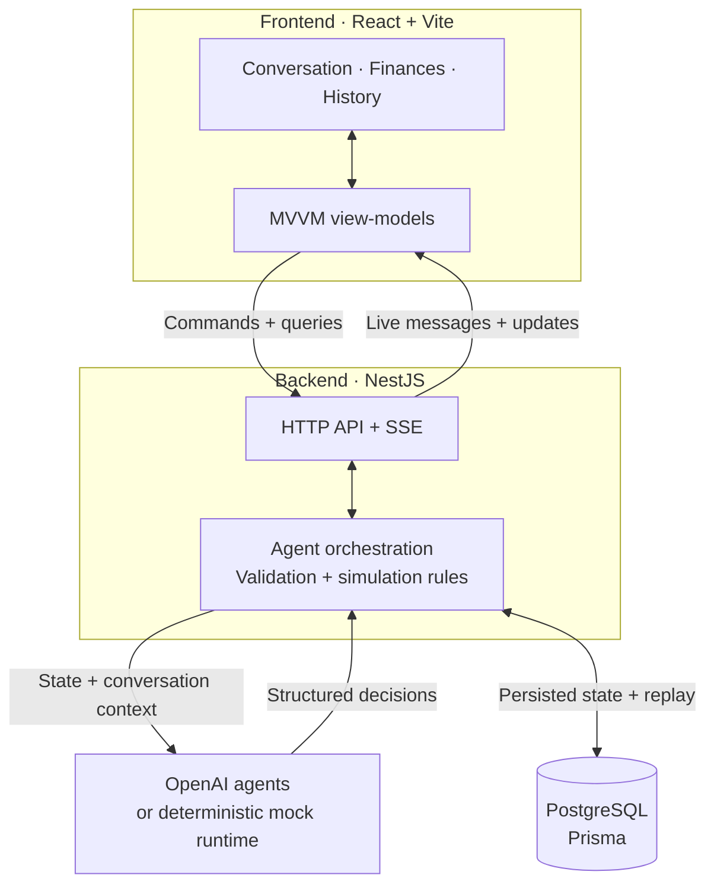

# LLM Trading Simulation

**A demo of inter-LLM communication through a trading simulation.**

Banker and Trader agents exchange messages, negotiate and manage simulated funds.
Configure their personalities, run the conversation and follow the resulting decisions.

## Demo

<video src="https://github.com/user-attachments/assets/26b2d792-fd2d-4ca8-b0fb-0db13a6d80a5" controls width="640"></video>

[Download the 70-second walkthrough (MP4, 0.8 MB)](docs/media/demo.mp4) · [Screenshots](docs/screenshots.md)

- Covers agent setup, personality configuration, running turns, round advancement, Finances and History.
- Recorded with the real application and database using deterministic mock agents. OpenAI mode runs the LLM agents.

## What you can explore

- **Agent communication:** public and private messages, streamed as turns run.
- **Personality configuration:** editable banker/trader rosters and six role-specific sliders.
- **Decisions with consequences:** negotiated payments, banker custody and simulated market positions.
- **Round settlement:** explicit advancement applies interest and eligible market settlements.
- **Inspection:** balances, opportunity terms, positions, saved round summaries and a filterable audit trail.
- **Responsive UI:** light/dark themes, animated activity and a scrollable conversation window.

All balances use **SIM**, a simulation currency. Turns advance the conversation; they do not advance the round.

## Run locally

Requires **Git** and **Docker with Compose**.

```sh
git clone https://github.com/ZakYeo/llm-trading-simulation.git
cd llm-trading-simulation
cp .env.example .env
docker compose up --build
```

- Open **<http://localhost:5173>**.
- Leave the API key empty for the mock demo.
- For OpenAI-backed agents, set `OPENAI_API_KEY` and `AGENT_RUNTIME_PROVIDER=openai` in `.env` before starting.

See the [setup and usage guide](docs/guide.md) for local Node development, configuration and testing.

## How it works



- The backend runs agents in sequence, validates their decisions and records the outcomes.
- The frontend sends operator commands and combines live updates with persisted session data.
- TypeScript contracts connect both sides; Zod validates model-facing decisions.

## More detail

- [Setup and usage](docs/guide.md) — runtime options, session controls and development commands.
- [Architecture](docs/architecture.md) — MVVM boundaries, agent execution and persistence.
- [Screenshots](docs/screenshots.md) — setup, conversation, finances, history and mobile views.
