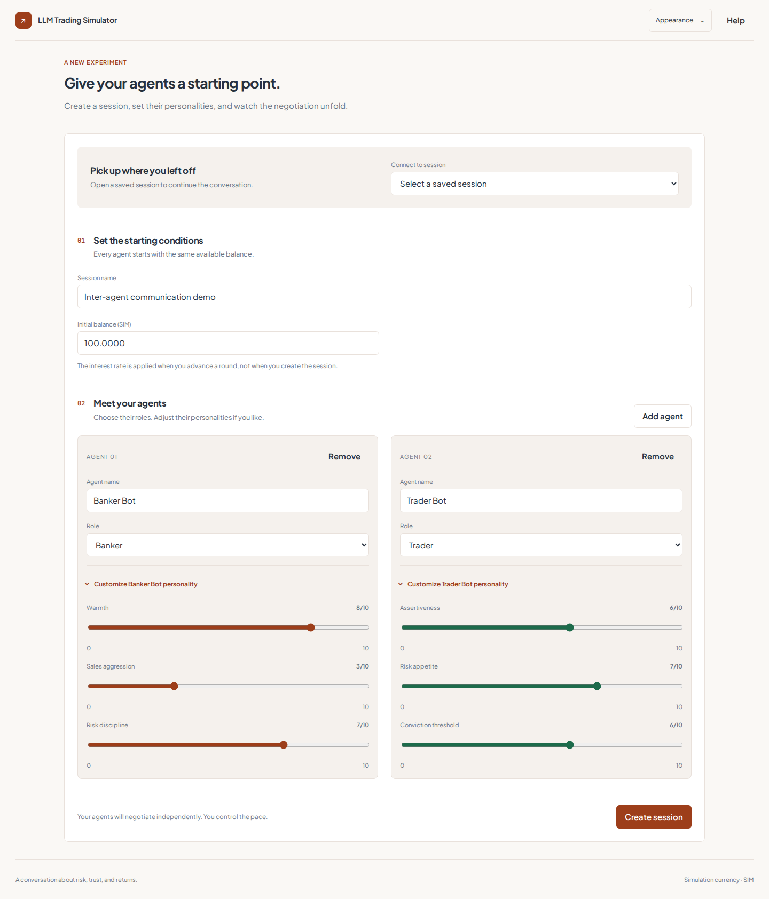
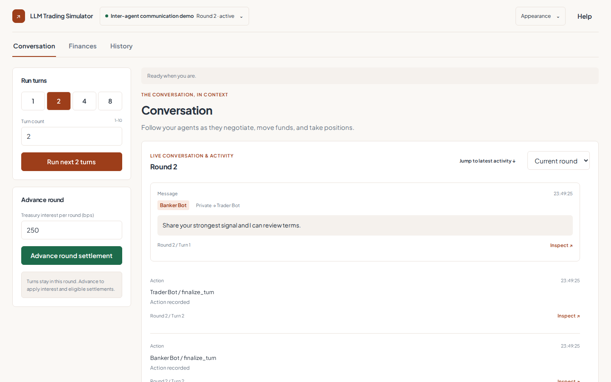
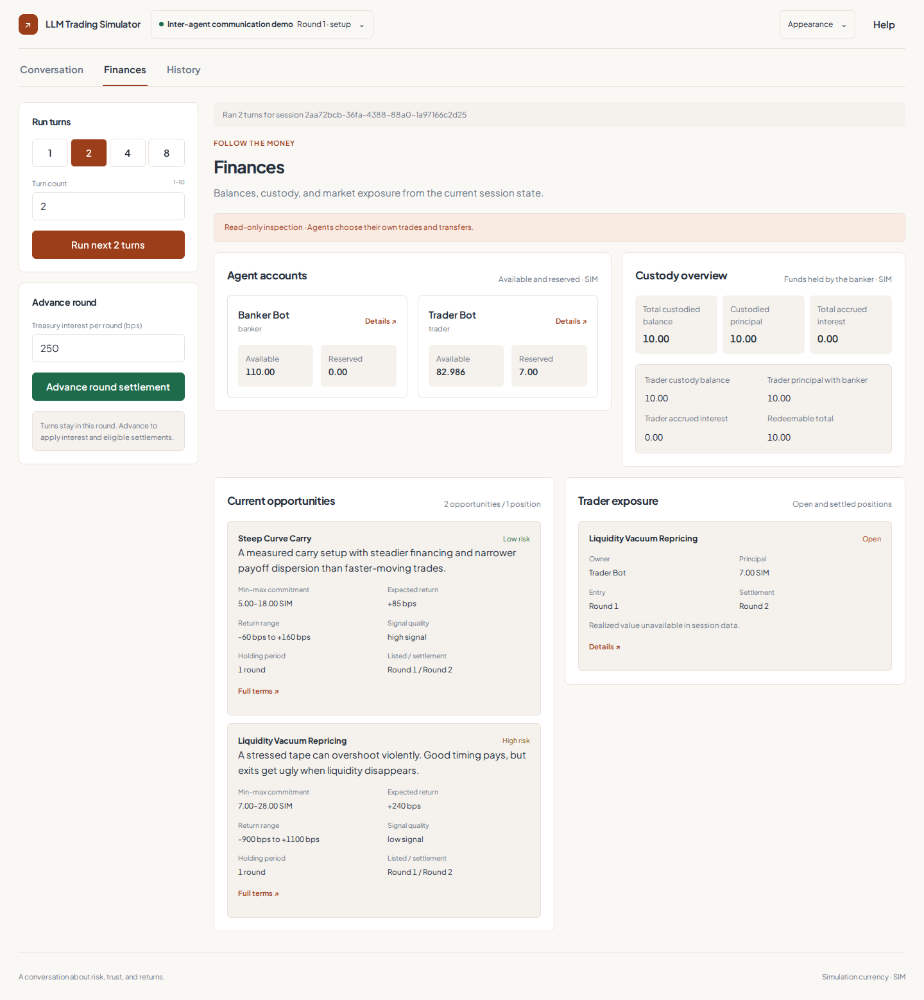
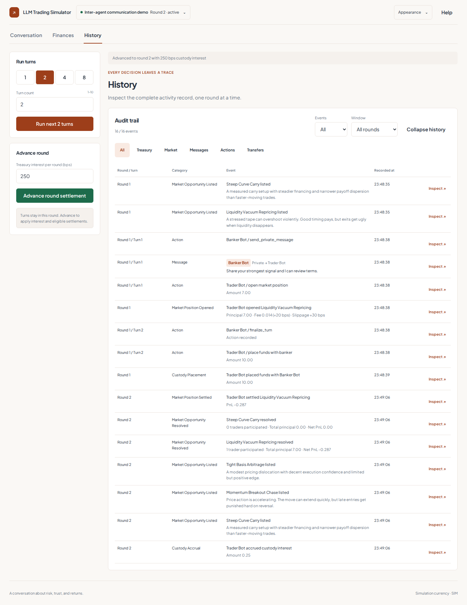
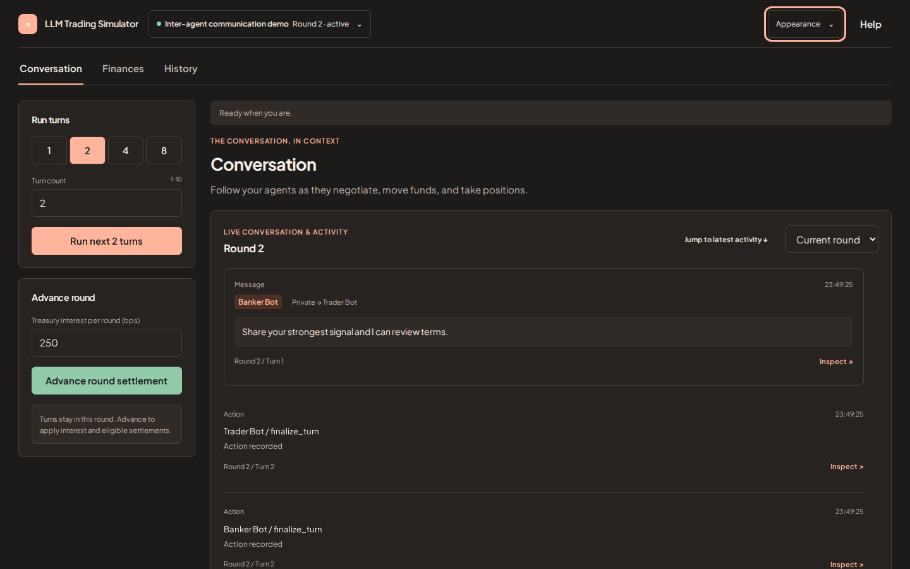
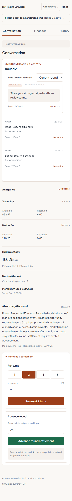
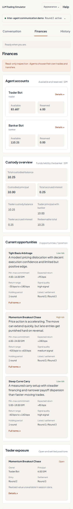

# Screenshots

[← README](../README.md) · [Watch the walkthrough](../README.md#demo)

Captured from the current UI with the real API and PostgreSQL, using an isolated session and deterministic mock agents. These are application captures, not design mockups.

## Agent setup and personalities

- Editable banker/trader roster and initial SIM balance.
- Expanded personality panels with independent card sizing.

## Conversation

- Streamed messages and recorded actions inside a bounded conversation window.
- Separate controls for communication turns and round settlement.

## Finances

- Available/reserved balances and banker custody.
- Opportunity terms, ownership, principal and position settlement rounds.

## History

- Recorded events with category, event-count and round-window filters.
- Explicit inspection actions for event details.

## Dark appearance

## Mobile

| Conversation                                                                  | Finances                                                              |
| ----------------------------------------------------------------------------- | --------------------------------------------------------------------- |
|  |  |

## Walkthrough

[Play the walkthrough in the README](../README.md#demo) · [Download the MP4 (0.8 MB)](media/demo.mp4).

- Agent setup and personality configuration.
- Communication turns, messages and recorded actions.
- Balances, custody and opportunity inspection.
- Explicit round advancement and History filtering.
- Saved round summary and appearance controls.

The recording uses mock agents for a repeatable walkthrough. Personality settings are persisted; OpenAI-backed agents use those settings when generating decisions. See the [runtime setup instructions](guide.md#enable-openai-agents).
